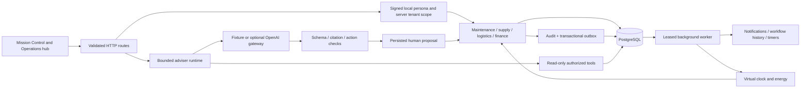

# The integrated local program

Helios remains one modular Next.js application with a separate long-running worker process and PostgreSQL. The worker boundary is justified by timer progression, retried delivery and recovery after process failure. Domain transitions remain direct calls inside explicit transactions.

## Transaction and concurrency boundaries

Work-order operations lock the asset and then the work order. Procurement and cargo resolve that same work order before locking their own rows. Inventory rows serialize competing reservations; budget rows serialize commitments; crew rows and a partial unique index prevent simultaneous active assignment. A dock-specific advisory lock protects interval-overlap checks. Different command IDs can compete safely; the command receipt separately protects replay of one request.

Stock is physical quantity and reservation state: `available = on_hand - reserved`, enforced with nonnegative database constraints. Cargo holds origin reservations; a work order holds destination reservations. Receipt transfers stock and budget commitment atomically, then reserves the delivered part for the work order. Completion consumes the part with incident resolution and postmortem creation in one transaction.

The PostgreSQL outbox closes the domain-write/publication gap. The current transport is a PostgreSQL queue with `SKIP LOCKED`, lease tokens, bounded retry scheduling, consumer receipts and dead-letter recovery. It does not claim Kafka transport or an independent network broker. Workflow projections read current authoritative domain state so a late event cannot regress their visible state.

## Time and simulated physics

Telemetry timestamps and the organization clock share virtual time. Manual advancement samples an endpoint and persists energy balance; it does not synthesize every skipped sensor interval. A resumed worker derives elapsed wall time, applies the selected multiplier, and limits offline catch-up to 60 wall seconds per tick. Billing periods and crew certification checks use virtual time. Audit timestamps, retry deadlines, approval expiration and worker health use wall time.

The energy model has solar output, critical and industrial demand, finite battery capacity and a constant-load reserve forecast. It is an educational balance model, not an engineering simulator for actual life-support systems.

## Intelligence and knowledge

The runtime has a named prompt version, a fixed read-tool plan, at most eight steps, recorded input/output/status/duration, a provider timeout, structured recommendation validation, and a terminal result. Proposed writes bind their exact action and resource into an approval record. A human decision reruns domain rules inside the approval transaction. The agent never receives SQL execution or physical-control tools.

Documents are versioned and chunked. Retrieval combines PostgreSQL full-text ranking and normalized 128-dimensional token-hash vectors stored in PostgreSQL arrays. This explicitly named local baseline is not a learned embedding model. Only the latest approved document version is eligible, with tenant filtering before ranking. Source-ID validation proves provenance; it does not automatically prove claim entailment. Evaluation reports this distinction.

The optional OpenAI adapter uses a strict structured-output schema and handles failed/incomplete responses. It is disabled by default and requires an explicitly configured model and API key. See [OpenAI structured outputs](https://developers.openai.com/api/docs/guides/structured-outputs) for the provider contract. No live-model measurement is inferred from fixture tests.

## Finance and operations

Payment intent commits before the separately transacted simulated provider charge. The timeout scenario therefore leaves an observable uncertainty gap. Reconciliation and signed webhooks settle the existing attempt; provider keys and journal references prevent duplicate financial effects. Money is integer cents. Deferred database checks reject unbalanced journal commits, and posted entries cannot be edited or appended to in another transaction.

OpenTelemetry request spans are exported locally into tenant-scoped PostgreSQL records, with best-effort delivery and bounded buffering. Structured request logs remain available independently. Platform metrics show sample counts and observed latency rather than invented service guarantees. The integration follows [Next.js OpenTelemetry guidance](https://nextjs.org/docs/app/guides/open-telemetry).

## Deliberate boundaries

Identity is still a local fixture mechanism. There is no public production authentication, AWS deployment, real payment provider, learned embedding provider, or live-model evaluation in the default local program. The original enterprise catalog remains a direction rather than a claim that every listed administrative feature exists. The implemented workflows and their evidence define the delivered scope.
