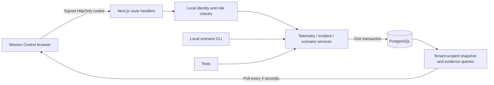
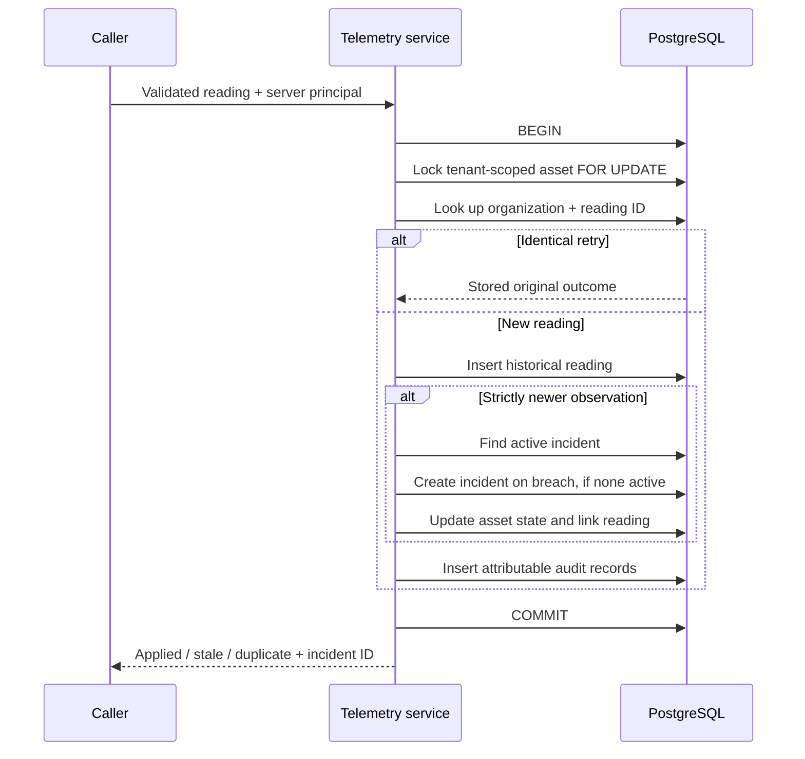

# First-slice architecture

One Next.js Node.js process serves the UI and API. HTTP handlers perform request validation and identity checks; server modules execute domain operations using PostgreSQL transactions. Pure domain functions supply threshold evaluation and deterministic telemetry generation.

The browser's role is to present and request operations. It supplies asset identifiers and command payloads, never trusted organization identity. `Principal` is created server-side from a signed session persona. Direct CLI calls are privileged local development operations.

## Ingestion transaction

The per-asset lock serializes transitions that would otherwise race. Every scenario and incident transition acquires the same asset lock before changing related state. A partial unique index on unresolved incidents independently guards the invariant. Composite foreign keys stop relationships from crossing organization boundaries.

For a timed-out write, callers can replay the same stable ID. A scenario's request identity covers its kind, seed, and asset. The scenario generates deterministic reading IDs and commits the whole batch plus its result atomically. It is a bounded operation, not a durable background job.

The query layer reads a consistent snapshot using a repeatable-read, read-only transaction. UI counts, readings, and asset state therefore describe the same committed database state.

## Identity boundary

The local demo offers an operator in Helios, an operator in Selene, and a read-only Helios auditor. Session signatures and expirations are verified server-side. The client cannot switch tenants by sending a header or JSON field. Mutations require a same-origin request.

This mode is intentionally available only with `DEMO_MODE=true` and a loopback `APP_ORIGIN`. The launch scripts bind to loopback. These are development boundaries; a production deployment requires real authentication and authorization provisioning. Database row-level security is not configured; query scoping and composite references are explicit in code.

## Time and ordering

Virtual observation time starts at 2042-03-19 14:20 UTC. Fixtures establish 36 observations. Scenario runs add twelve five-second ticks. Exact dates and units are visible in Mission Control.

Latest state uses strictly increasing observation timestamps. An older or equal-time distinct reading remains queryable but does not alter state or create an incident. This is a deliberately simple ordering policy. A multi-sensor system will need per-stream sequence/version rules and an explicit late-anomaly policy.

Incident opening and operator transitions use virtual time. Audit records capture wall time. Correlation identifiers connect a scenario, its readings, and the resulting incident; later operator commands have their own correlations and link through the incident resource ID.

## Evolution triggers

Add an outbox/worker boundary when work must continue after a process crash or be delivered outside this transaction. Add a real identity provider before exposing access beyond the local demo. Introduce metrics and distributed tracing when synchronous request/audit records no longer explain failures. Extract a deployable only after measuring a boundary that benefits from independent scaling or failure isolation.

Implementation reference: [Next.js Route Handlers](https://nextjs.org/docs/app/api-reference/file-conventions/route). The lock behavior is documented in [PostgreSQL explicit locking](https://www.postgresql.org/docs/17/explicit-locking.html).
