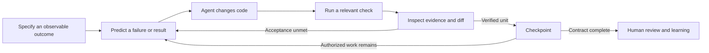

# Lesson 2: engineering with a coding-agent loop

Learning outcome: you can give an agent a bounded objective and a reliable way to discover whether it has succeeded. You can improve the surrounding workflow when a stronger prompt alone would not solve the problem.

## The loop in this repository

The model generates actions, but the environment supplies evidence: code, tool results, database state, tests, and rendered behavior. Your engineering responsibility is to choose which evidence actually establishes the outcome.

For example, “make incident processing robust” is hard to evaluate. “Twelve simultaneous deliveries of the same reading leave one reading, one incident, and one set of audit effects” is concrete. It supplies both a task and a testable failure mode.

## A contract you can review

Use [the task template](../templates/task-contract.md). Include an outcome, scope, inputs, acceptance checks, permissions, stop conditions, and one learning target. State behaviors without dictating every implementation detail.

For the maintenance slice that was built after M01, the contract required exactly one work order per incident, server-enforced tenant isolation, valid initial state, and an inspectable UI. Reconstruct those requirements before reading the implementation. Choosing a work-order ID scheme could be left to the agent. Defining what counts as duplicate creation could not.

Read the agent's proposed contract before a long run. Look for omitted failure conditions, hidden scope growth, and assertions that could pass without the intended behavior. A contract is useful only if you can judge the result independently of the implementation narrative.

## Improve more than the prompt

| Observed failure                              | Useful intervention                                                      |
| --------------------------------------------- | ------------------------------------------------------------------------ |
| The agent cannot reproduce a bug.             | Supply or build a deterministic fixture and a focused command.           |
| It repeatedly searches unrelated code.        | Give the entry point, relevant contract, and a small source map.         |
| It claims completion after a screen renders.  | Require an assertion against committed database state.                   |
| It changes many modules at once.              | Narrow the task boundary and require one verified unit before expanding. |
| It reruns a failing command without learning. | Request a hypothesis and an experiment that distinguishes explanations.  |
| It loses progress in a fresh session.         | Improve the checkpoint and the repository entry point.                   |
| It passes a test by weakening it.             | Compare the test and diff against the original acceptance criterion.     |

The environment built here includes `db:seed`, `scenario`, integration tests, and a health route because agents need observable operations. Improving one of those tools can be more valuable than adding more prose to a master prompt.

## Make checks capable of rejecting bad work

Inspect [the integration suite](../../tests/integration/mission.test.ts). Its concurrent-delivery test inspects committed outcomes rather than counting calls to a mocked helper. Its rollback test creates a conflict partway through a scenario and checks that earlier writes did not survive.

An assertion can still be incomplete. The test author and implementer may share the same mistaken assumption. Before trusting a test, describe a plausible broken implementation and explain whether the assertion rejects it. For critical changes, ask a reviewer to inspect the original requirement before reading the implementation summary.

## Give corrections that preserve progress

Weak correction: “Do better and make it production ready.”

Useful correction: “The UI check does not establish persistence. Keep the implementation, reconnect through a new database pool, and assert the same incident and trigger reading still exist. Report this separately from browser rendering.”

A good correction identifies the evidence gap and the next useful action. It does not need to prescribe a total rewrite.

## Your practice

Choose one completed acceptance criterion from [Run 001](../../docs/exec-plans/001-telemetry-incident.md). Write the strongest claim the existing evidence supports, one stronger claim it does not support, and one check that would close the gap. Have the agent critique your distinction in REVIEW mode.

For Codex-specific workflow context, official [best practices](https://learn.chatgpt.com/guides/best-practices) recommends clear task context, constraints, completion conditions, and reusable repository instructions. The exercises here apply those ideas to Helios.
