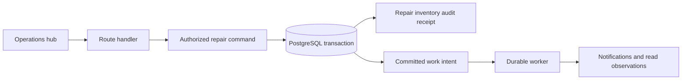

# Worked design: Explain and extend a transactional repair workflow without overstating its boundaries

## Start with a bounded user journey

An authorized operations user completes a prepared repair, sees the committed workflow outcome, and can safely reconcile a lost response using the same command identity. Notifications and read projections follow committed state without becoming the authority for repair completion.

The invariant is: **A repair completion either commits every included domain effect and its receipt, or commits none; replay of a successful logical command does not consume inventory again.**

Non-goals: Do not reimplement the completed workflow, claim real physical control or live payment guarantees, or split the modular monolith into services solely to make the diagram larger.

Before choosing infrastructure, write three acceptance examples: an ordinary successful operation, a repeated or conflicting operation, and an unavailable dependency. Define what the user can still do in each case. A phrase such as highly available is incomplete until you name the operation and the behavior allowed when a dependency fails.

## Worked target architecture

This is the teaching design to evaluate, not a deployment inventory. [Source observations](README.md) distinguish what is present from what is proposed.

Start from the documented repair transaction and trace the writes that belong to it. Reservation consumption, work-order completion, releases, audit, postmortem, and receipt persistence need a coherent accepted outcome. The existing late-failure regression is valuable because a failure near the end tests whether earlier effects truly share the rollback boundary.

Keep HTTP concerns outside the authorized domain operation. The browser supplies intent, not trusted tenant identity. A command receipt must be scoped and tied to the accepted effect so a response-lost retry can recover the prior result. A failed rolled-back attempt and a replay after success are different states; use both in the explanation.

Background work should originate from committed intent. A worker may retry delivery or projections, but a notification failure must not turn an accepted repair into an uncommitted one. Conversely, sending an external action before the transaction commits can create an effect the local rollback cannot erase. The project's simulated adapters must remain explicitly distinguished from any future real-world integration.

A modular monolith is a useful boundary while the repair invariant spans several tables. Splitting inventory, work orders, and receipts into independent services would change the atomicity problem, not simply improve scalability. A later separation needs a new business contract for intermediate states and reconciliation, plus evidence that the operational benefit justifies the added failure modes.

## Read the diagram as a set of obligations

For each arrow, state the caller, trust context, timeout or transaction boundary, and observable outcome. Label a database write differently from a notification hint or a local draft update. A line crossing into a worker or provider is a potential failure window; it does not inherit atomicity from an earlier database transaction.

Choose one authoritative record for each decision. Derived caches and UI projections can be rebuilt only if the source of truth and reconstruction policy are clear. A read replica or cached response can be appropriate for some reads while being inappropriate for the admission decision that protects the invariant. Name that distinction before adding either component.

## First implementation slice and later growth

The first proposed slice should support the bounded journey with the existing architecture wherever possible. Include contract validation, authorization, the decisive state transition, a truthful response, and the focused regression that rejects the named failure. If the existing code already meets the behavior, the useful work is characterization and evidence rather than replacement.

Scale in response to a specific bottleneck. More stateless API instances may help request handling while leaving a hot row, connection limit, provider quota, or downstream queue unchanged. A queue can smooth a burst but cannot make sustained arrival exceed processing capacity indefinitely. A cache can reduce eligible reads but adds identity and freshness obligations.

Explain one alternative that could be correct under different requirements. Use the [decision record](05-design-decisions.md) to state the cost of your choice and the observation that would make you reconsider it. The goal is a design another engineer can challenge with a concrete failure, not the largest possible collection of boxes.
